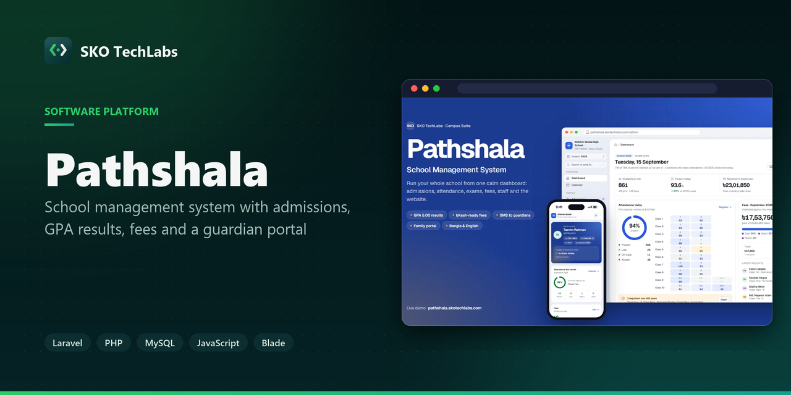
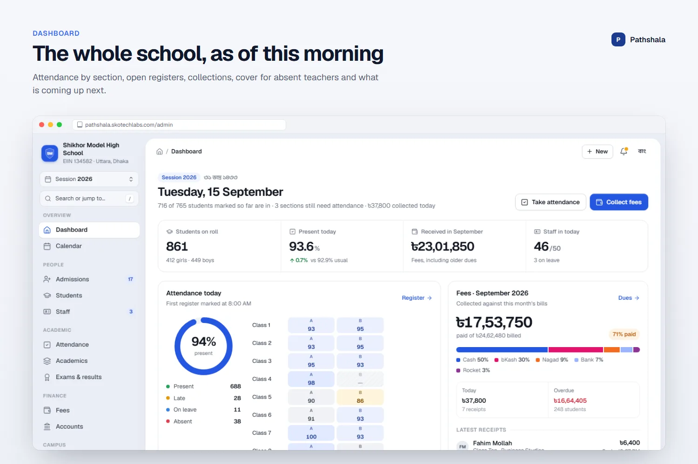
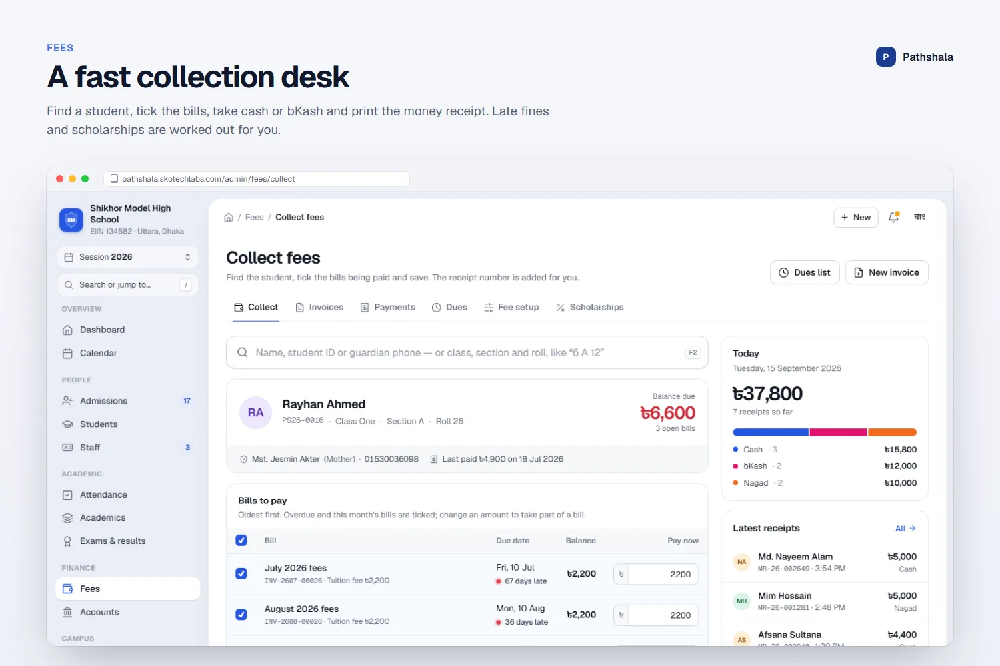
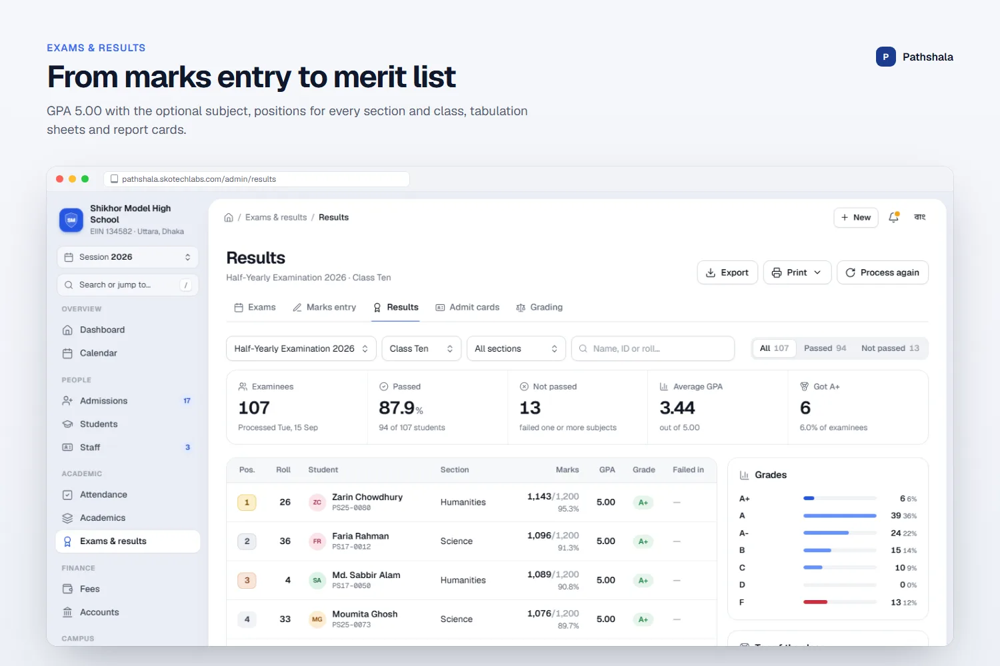
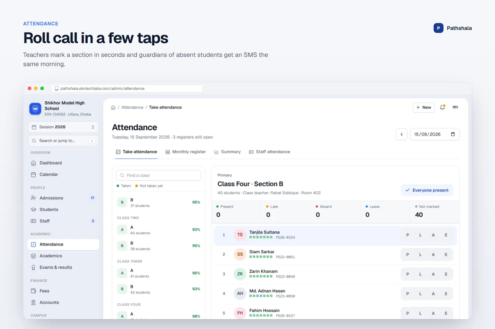
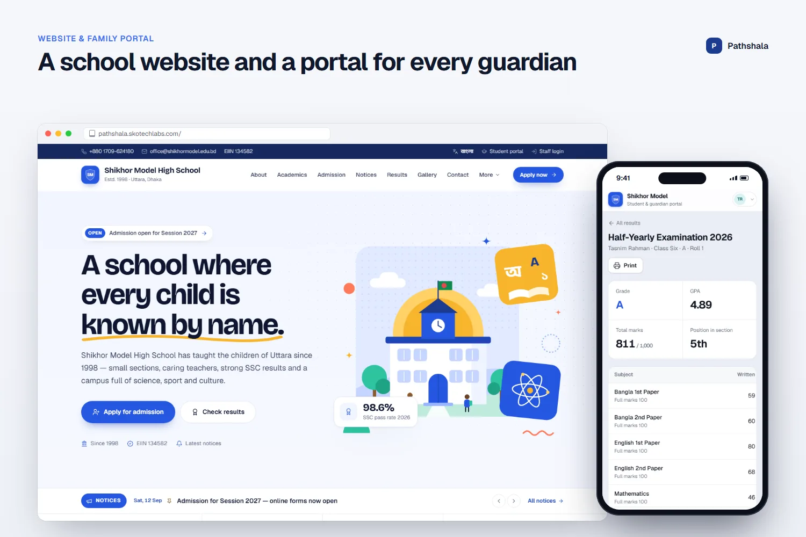

<h3>School management system with admissions, GPA results, fees and a guardian portal</h3>

A complete school management system: admissions, students, attendance, class routine, exams with GPA report cards, fees and receipts, payroll, library, transport, SMS, a school website and a guardian portal, all managed from one calm admin dashboard.

   

<a href="https://pathshala.skotechlabs.com"><b>Live Demo</b></a> &nbsp;·&nbsp; <a href="https://skotechlabs.com/projects/pathshala-school-management-system"><b>Case Study</b></a> &nbsp;·&nbsp; <a href="https://skotechlabs.com/contact"><b>Request a Demo</b></a> &nbsp;·&nbsp; <a href="https://github.com/skotechlabs"><b>All Products</b></a>

---

## Overview

Pathshala runs a whole school from one dashboard. The office admits students online or at the desk, class teachers take attendance on their phones in seconds, the weekly routine shows which teacher is in which room, and guardians receive an SMS when a child is absent. The dashboard opens on today: who is in, which registers are still open, what has been collected, which classes need cover and what is coming up next.

Exams follow the national curriculum. Teachers enter creative, MCQ and practical marks in a keyboard-friendly grid, results are processed with the GPA 5.00 rules including the optional fourth subject, merit positions are calculated for every section and class, and the school prints tabulation sheets, admit cards and report cards with a QR verification code.

The accounts office collects fees at a fast collection desk. Monthly invoices are generated from the fee chart with scholarships, sibling discounts and transport fees, every receipt records the bKash or Nagad reference, the dues list sends reminder SMS in one click, and the cashbook and payroll show exactly where the money goes.

A modern school website is managed from the same console, with the homepage, notices, results lookup, online admission form, gallery and pages. Students and guardians follow attendance, results, fees and the routine in a mobile-first portal. Staff accounts use roles for the headmaster, office, accountant, teachers and the librarian, and every change is kept in an activity log.

<table>
<tr>
<td width="50%" valign="top">

### The Challenge

Most schools in Bangladesh still juggle attendance registers, fee books, Excel mark sheets and a separate website that nobody updates. The office cannot see which families owe fees, teachers spend evenings calculating GPA, and guardians only learn about an absence or a result days later. The system had to be simple enough for a busy office and teachers on basic phones, precise about GPA rules and money, and complete enough that the headmaster could run the school from one place.

</td>
<td width="50%" valign="top">

### Our Solution

We designed a calm, today-first admin dashboard on a server-rendered Laravel engine with a hand-built design system: a white workspace on a tinted canvas, one clear primary action per screen and keyboard-friendly bulk entry. Each module shares the same student, class and session records, so attendance feeds the dashboard and report cards, invoices feed the dues list and cashbook, and published results appear on the website and in the portal automatically. Roles decide who can view or change each module, a read-only demo lets visitors explore everything, and printable documents carry QR codes that anyone can verify online.

</td>
</tr>
</table>

## Key Features

- Today-first dashboard: attendance by section, open registers, fee collection, classes needing cover, admissions pipeline, results and upcoming events
- Admissions pipeline from online application to admitted student, with test scores and printable forms
- Student profiles with enrollment history, attendance calendar, results, invoices and scholarships
- Phone-friendly attendance for class teachers, monthly registers and absence SMS to guardians
- Classes, sections, SSC groups, subjects, subject teachers, bell schedule and a clash-aware class routine
- Exams with CQ, MCQ and practical marks entry, GPA 5.00 processing, merit positions, tabulation sheets, admit cards and QR report cards
- Fee chart, monthly invoice generation, collection desk, receipts with bKash and Nagad references, dues and reminders
- Cashbook for income and expenses, payroll with salary slips, staff attendance and leave approvals
- Library, school transport routes, homework, promotion to the next session, ID cards and transfer certificates
- School website managed from the console: homepage, notices, results lookup, online admission, gallery and pages
- Student and guardian portal, SMS and email broadcasts, roles and permissions, activity log
- Reports for student strength, attendance shortfall, result analysis, fee collection and income and expense, ready to print or download
- Full Bangla and English interface with Bangla digits and the Bangla calendar

## Business Impact

- Attendance for a full section taken on a phone in under a minute
- Report cards for a whole class processed and printed in one step
- Every taka traceable from invoice to receipt to cashbook
- Guardians informed the same day about absences, dues and results
- One codebase serving the admin console, website and portal

## Screenshots

<table>
<tr>
<td width="50%" valign="top"> The whole school, as of this morning</td>
<td width="50%" valign="top"> A fast collection desk</td>
</tr>
<tr>
<td width="50%" valign="top"> From marks entry to merit list</td>
<td width="50%" valign="top"> Roll call in a few taps</td>
</tr>
<tr>
<td width="50%" valign="top"> A school website and a portal for every guardian</td>
<td width="50%"></td>
</tr>
</table>

> See it running: **[pathshala.skotechlabs.com](https://pathshala.skotechlabs.com)**

## Technology Stack

## Source Code & Licensing

This repository is the public showcase for **Pathshala**. The production source code is proprietary and is maintained privately by SKO TechLabs.

Interested in this product for your business? We offer:

- **Ready-to-launch deployment** of Pathshala under your own brand and domain
- **Customisation** of features, workflows, languages and integrations to fit how you work
- **Custom development** of a new product built on the same foundations
- **Ongoing support**, hosting, maintenance and feature roll-outs after launch

## Get in Touch

---

© 2026 <a href="https://skotechlabs.com">SKO TechLabs</a> · Dhaka, Bangladesh · Building intelligent digital solutions

